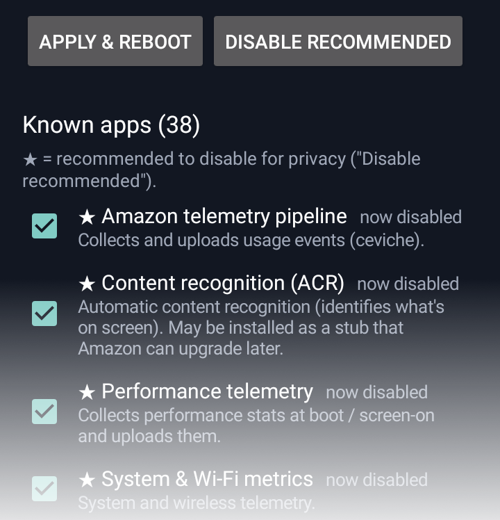

# ExtinguishTV

An Android phone app that turns off Amazon telemetry, ads and unused bloat on Fire TV devices and
Fire TV Edition smart TVs. It connects to the TV over your local network using ADB and disables
apps with `pm disable-user`. Nothing is uninstalled, and every change can be undone from the app.

Not affiliated with or endorsed by Amazon. "Fire TV" is a trademark of Amazon.com, Inc.

Why the fuck do I even need to any time into this bullshit I hate the current state of TVs, this TV
was super sluggish because by default background apps fill up all of the ram and even swap.

This is Vibecoded, I dont like Java and this matter calls for the least amount of effort.

## Why a seperate app?

- Makes it easier to use on multiple different TVs
- A local ADB connection on the TV (to 127.0.0.1) did not work for me, also navigating the UI through the TV would probably be pretty clunky so this is better anyways

## Before you start: compatibility and risk

- **Tested on one TV only:** a TCL Fire TV Edition (model AFTANNA0) running Fire OS 7.7.1.2. Other
  models and Fire OS versions ship different apps. Some apps that are safe to disable here may be
  required elsewhere, and the list of apps Fire OS refuses to disable may differ.
- **Always-running apps are detected at runtime** and can't be ticked, because disabling one can
  make Fire OS restart it in an endless crash loop. Everything else is your call.
- **App descriptions are informed guesses.** They are inferred from each app's declared components
  and permissions, not from its code. Treat phrases like "appears to" literally.
- **Unknown apps are untested.** Amazon apps that aren't in the catalog are listed without a
  description. If you disable one that breaks the TV's network connection, the app can't reach the
  TV to undo it, and recovering may need a factory reset. The app asks for confirmation first.
- **Fire OS updates may turn apps back on.** Open the app after an update and apply again.

Use at your own risk.

## Setup

1. On the TV, enable developer options: **Settings → My Fire TV → About**, then click the device
   name about seven times.
2. Turn on **Settings → My Fire TV → Developer Options → ADB Debugging**.
3. Find the TV's IP address: **Settings → My Fire TV → About → Network**.
4. Install `ExtinguishTV.apk` from the releases page on an Android phone (Android 7 or newer) that's
   on the same network. Allow installs from unknown sources if asked.
5. Open the app, enter the TV's IP and press **Connect**. The TV asks **"Allow USB debugging?"**.
   Tick **Always allow** and choose **OK**.

## Using it

Checked means disabled. Checkboxes start at the TV's current state, so nothing changes unless you
change something.

- **Apply & reboot** applies the checkboxes, checks that each change took effect, then reboots the TV.
- **Disable recommended** additionally ticks the privacy entries marked ★ (telemetry, ads, content
  recognition, Wi-Fi password upload, remote support) and applies. It never unticks anything.

The list has four sections:

- **Known apps:** apps in the catalog, with a description.
- **Unknown Amazon apps:** installed `com.amazon.*`, `amazon.*`, `com.fireos.*` and `com.ivona.*`
  packages that aren't in the catalog.
- **Missing / not found:** catalog entries that aren't installed on this TV.
- **Can't be disabled:** apps Fire OS protects, always-running apps, apps other parts of the
  system depend on (home screen, settings, keyboard, WebView, network connectivity).

To undo everything, untick all boxes and apply.



## Building

Needs Docker only. The image contains JDK 17 and the Android SDK; the build uses plain SDK tools,
no Gradle.

```sh
docker build -t extinguishtv-build .
docker run --rm -v "$PWD:/src" extinguishtv-build sh tools/new-keystore.sh   # once
docker run --rm -v "$PWD:/src" extinguishtv-build                            # -> build/ExtinguishTV.apk
```

`tools/new-keystore.sh` creates the signing key `keystore.jks` with a random password in
`keystore.password`. Both are git-ignored.

The password can also come from the `KEYSTORE_PASSWORD` environment variable.

## Contributing

The app list lives in [`Catalog.java`](app/src/com/github/kinsi55/extinguishtv/Catalog.java).
Findings from other models and Fire OS versions are welcome. Include the model, Fire OS version,
and what broke or didn't.